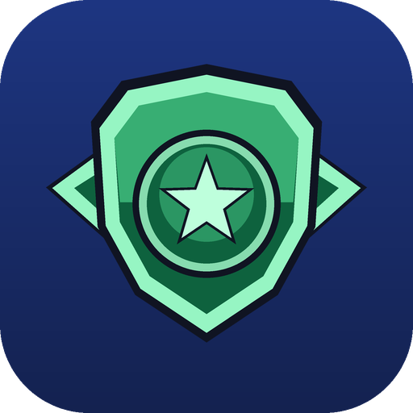

  

<h1 align="center">RetroHome</h1>

  <b>Your retro library, presented like a modern console.</b> 
  A controller-first home screen for your emulated games, with RetroAchievements built in. 
  Made for the Steam Deck, just as at home on a Windows PC.

  <a href="../../releases/latest"><b>⬇ Download the latest release</b></a>

> [!IMPORTANT]
> **RetroHome requires [EmuDeck](https://www.emudeck.com/).**
> RetroHome is the front end: it shows your games and tracks your achievements. **EmuDeck
> installs and configures the emulators that actually run them.** Install EmuDeck first
> (Steam Deck or Windows), let it set up your emulators and `Emulation/roms` folder, then
> install RetroHome. Without EmuDeck, games won't launch.

---

## Why RetroHome?

You've got hundreds of games spread across dozens of emulators. RetroHome turns that folder of
ROMs into something that feels like switching on a console: your games front and centre, the
right emulator launched with one press, and every achievement you earn tracked, celebrated and
counted towards your own level.

## Features

### 🎮 A home screen worth coming back to
- Your games in a sleek, scrolling row, with **box art fetched automatically**
- **Game screenshots fade in behind** whatever you're browsing
- Recently played first, favourites one press away, and a full library grid for big collections
- Fits your screen perfectly, from the Steam Deck to 1440p, 4K and ultrawide monitors

### ⚡ One press to play
- Built on top of **EmuDeck**: it finds your EmuDeck ROM folder and launches every game
  through the emulators EmuDeck installed and configured
- The right emulator for each console, automatically: RetroArch, DuckStation, PCSX2,
  Dolphin, PPSSPP, Cemu, RPCS3 and many more
- Multi-disc games show up once, and you choose your disc when you hit Play
- Play time is tracked for every game

### 🏆 RetroAchievements, front and centre
- Sign in once and see your progress on every game: points, badges, and the next achievement to chase
- Recent unlocks and the games you're halfway through, right on the home screen
- Your library shows **only the games that have achievements**, so you always know what's worth playing
- A full achievement list for any game, with rarity, unlock dates and hardcore status

### 📈 Level up as you play
- Every achievement earns XP towards **your RetroHome level**, and rarer achievements are worth more
- Your level is shown as a **crest that keeps evolving**. Unlock new looks as you climb.
- Finish a game for a **Platinum**, or 100% it in hardcore for a **Mythic**
- Show them off in your **trophy case** and on your profile

### 📋 After-action report
Close a game and get a proper debrief: every achievement you unlocked, the XP you earned, your
progress in that game, and your XP bar filling up as you level, just like your favourite shooters.

### 📚 Discover new games
- Browse **every console and every game on RetroAchievements**, right from your couch
- Open any game in the **built-in browser**. Downloads are **unpacked and filed into the right
  folder automatically**, ready to play.

### 👥 Made for sharing
- Multiple users with their own achievements, favourites, history and optional PIN
- Optional online accounts to keep your profile in sync across devices

### 🕹️ Controller-first
Every screen works with a gamepad: Steam Deck, Xbox, PlayStation and Switch Pro controllers.
Keyboard works too.

## Get started

**1. Install EmuDeck (required).** Get it from [emudeck.com](https://www.emudeck.com/) and run
its setup on your Steam Deck or Windows PC. It installs the emulators and creates your
`Emulation/roms` folder. Put your games in the matching console folders (`roms/snes`,
`roms/psx`, …).

**2. Install RetroHome.**

**Windows:** download `RetroHome-…-Windows-x64.zip` from
[Releases](../../releases/latest), unzip it anywhere, and run `RetroHome.exe`.

**Steam Deck:** download `RetroHome-…-Linux-SteamDeck-x86_64.tar.gz` in Desktop Mode, extract it,
and run `install-steamdeck.sh`. It adds RetroHome to your apps and shows you how to add it to
Steam for Game Mode.

**3. First launch:** choose your EmuDeck ROM folder (it's found automatically) and sign in with your RetroAchievements username and
**Web API key** (on retroachievements.org: *Settings → Keys*). That's it.

> Windows may say "Windows protected your PC" the first time. Click **More info → Run anyway**.

## Good to know
- **EmuDeck is required for now.** RetroHome doesn't install or configure emulators itself; it
  hands each game to the emulator EmuDeck set up. Support for other setups may come later.
- To earn achievements, sign in to RetroAchievements inside your emulators too (e.g. RetroArch).
- Only download games you're entitled to play.
- Power users: custom emulator setups, the online server and building from source are covered in
  the [full guide](docs/GUIDE.md).

RetroHome is a fan project and isn't affiliated with RetroAchievements, EmuDeck or any console maker.

